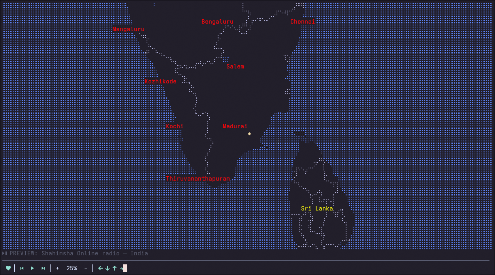

<div align="center">

# RadioGlobe

**A fun, engaging, and keyboard-driven terminal radio player and interactive world map explorer.**

[](https://www.rust-lang.org/)
[](https://ratatui.rs/)
[](https://mpv.io/)
[](LICENSE)



_Explore global radio stations with smooth geospatial panning, zooming, and interactive rendering directly in your terminal. Play random radio from differnt parts of the world._

</div>

---

## ✨ Features

- **Interactive World Map**: Explore global radio stations with spatial panning (`hjkl`, WASD, arrows) and multi-level zooming (`i`/`o`, `+`/`-`), powered by custom generic map rendering.
- **Robust Audio Streaming**: Seamless background playback powered by `mpv`, featuring non-blocking process management, auto-reaping, and instant status updates.
- **Favorites System**: Bookmark your favorite stations with `f` (marked with a red heart `♥`), persisted in session state for instant recall.
- **Keyboard-Driven TUI**: Fully navigable via intuitive hotkeys with zero terminal flicker when idle, reacting instantly to keyboard and terminal resize events via `Crossterm` and `Ratatui`.
- **Adaptive Layout**: Tab-toggleable compact status view and fullscreen map explorer suited for any terminal dimensions.

---

## 📦 Installation & Quick Start

### Prerequisites

Ensure you have the following installed on your system:

1. **Rust Toolchain** (Edition 2021+) — [Install Rust](https://www.rust-lang.org/)
2. **`mpv` Audio Player** — Required for stream decoding and playback:
   - _Debian / Ubuntu_: `sudo apt install mpv`
   - _macOS_: `brew install mpv`
   - _Arch Linux_: `sudo pacman -S mpv`
3. **A Nerd Font** — Recommended for crisp UI icons and status badges in your terminal emulator.

_(For detailed compilation instructions across Linux, macOS, and Windows, see [BUILDGUIDE.md](BUILDGUIDE.md))_

### Build and Run

```bash
# Clone the repository
git clone https://github.com/MysticGanesh/RadioGlobe.git
cd RadioGlobe

# Build and run in release mode
cargo run --release
```

---

## ⌨️ Controls & Interactive Keymaps

| Key                           | Action          | Description                                            |
| :---------------------------- | :-------------- | :----------------------------------------------------- |
| `Space`                       | Play / Pause    | Toggle audio playback for the active station           |
| `Enter`                       | Select & Play   | Focus and connect to the currently highlighted station |
| `f`                           | Toggle Favorite | Bookmark or unbookmark the selected station (`♥`)      |
| `h j k l` / `WASD` / `Arrows` | Pan Map         | Navigate across the global world map view              |
| `i` / `+`                     | Zoom In         | Zoom into detailed regional station clusters           |
| `o` / `-`                     | Zoom Out        | Zoom out for global macro view                         |
| `n` / `p`                     | Next / Previous | Jump sequentially through available stations           |
| `Tab`                         | Tab Toggle      | Switch between full explorer and compact control modes |
| `q`                           | Quit            | Safely stop audio stream and exit application          |

---

## 🛠️ Architecture & Tech Stack

`RadioGlobe` is engineered with clean modularity and robust tooling:

- **Language**: **Rust** for concurrency, memory safety, and robust systems programming.
- **TUI Framework**: [Ratatui](https://ratatui.rs/) for expressive, widget-based terminal user interfaces.
- **Terminal Backend**: [Crossterm](https://github.com/crossterm-rs/crossterm) for raw mode handling, keyboard events, and cross-platform terminal control.
- **Audio Engine**: `mpv` CLI subprocess controller (`src/player.rs`) ensuring robust stream handling without blocking the event loop.
- **Geo-Spatial Engine**: `TerminalMap` subcrate (`TerminalMap/`) handling Mercator tile fetching, canvas rasterization, and vector marker projection.

---

## 📂 Project Structure

```tree
RadioGlobe/
├── Cargo.toml               # Workspace & crate configuration
├── stations.json            # Curated global radio stations metadata (lat, lon, streams)
├── BUILDGUIDE.md            # Cross-platform compilation guide
├── src/
│   ├── main.rs              # Entry point & async event/render loop
│   ├── app.rs               # Application state, favorites, and status management
│   ├── ui.rs                # Ratatui layout views, map widget, and status bars
│   ├── player.rs            # `mpv` subprocess audio controller
│   └── stations.rs          # Station data models and JSON deserializer
└── TerminalMap/             # High-performance terminal map rendering engine
    ├── Cargo.toml
    ├── src/                 # Canvas, camera, braille markers, tile rasterizers
    └── styles/              # Dark/bright cartographic theme definitions
```

---

## 📄 License

This project is licensed under the [MIT License](LICENSE).
